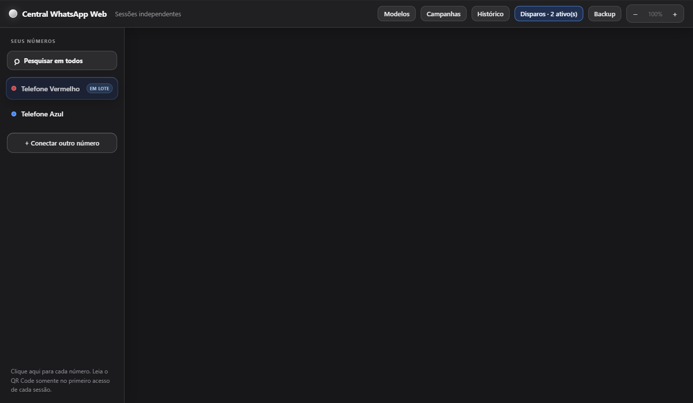
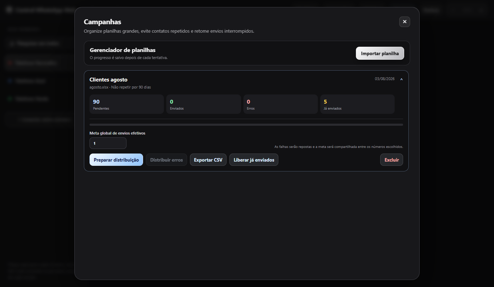
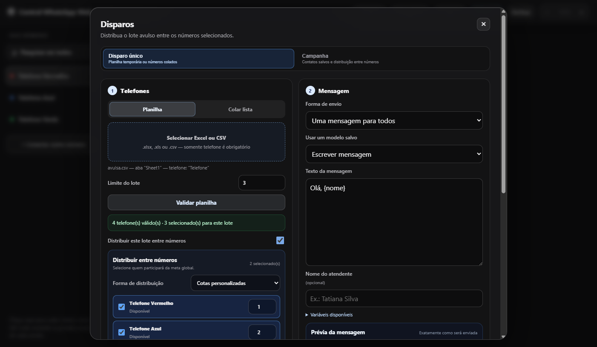
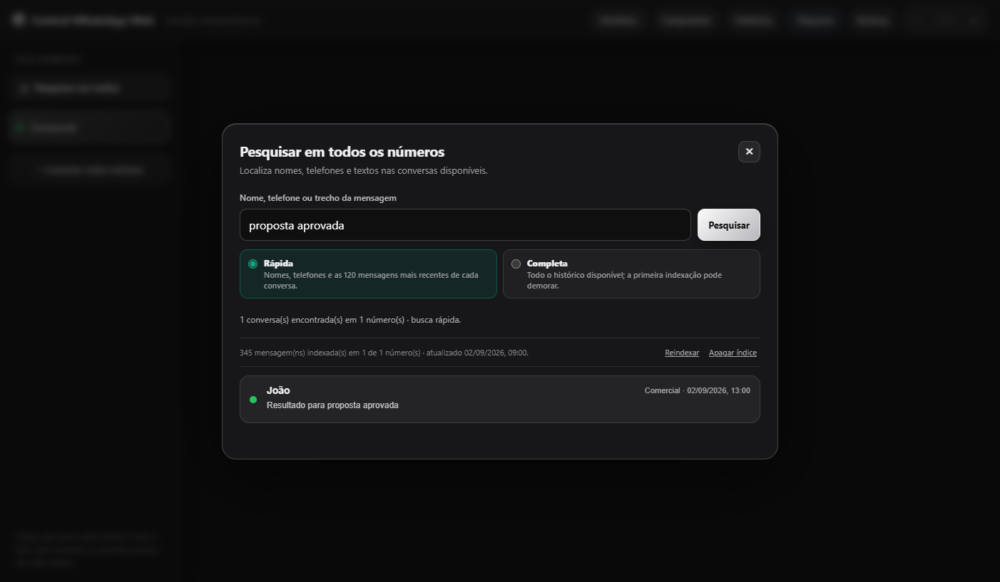

# Central WhatsApp Web

Use várias contas do WhatsApp Web em uma única janela, com sessões independentes.

## Exemplos de funcionalidades

**Sessões independentes:** acompanhe vários números e os envios ativos.



**Campanhas:** acompanhe listas, envios e erros e prepare uma distribuição.



**Distribuição:** divida uma lista entre números automaticamente ou defina cotas.



**Pesquisa global:** encontre nomes, telefones e mensagens em vários números.



## Para usuários

- [Baixar a versão 0.10.32 para Windows x64](https://github.com/Danfreitasp/central-whatsapp-web-updates/releases/download/v0.10.32/Central-WhatsApp-Web-Setup-0.10.32.exe)
- [Ver outras versões](https://github.com/Danfreitasp/central-whatsapp-web-updates/releases)
- Organize números, conversas, modelos de mensagem e histórico em um só lugar.
- Envie listas ou planilhas por um número ou distribua os contatos entre vários números.
- Os dados e as sessões ficam no computador onde o aplicativo está instalado.

## Para desenvolvedores

Requer Node.js e npm. Clone o repositório e execute:

```sh
npm ci
npm start
```

Para validar as alterações e gerar o instalador Windows:

```sh
npm test
npm run build
```

O instalador é criado na pasta `dist`. Consulte o código e abra issues neste repositório.
